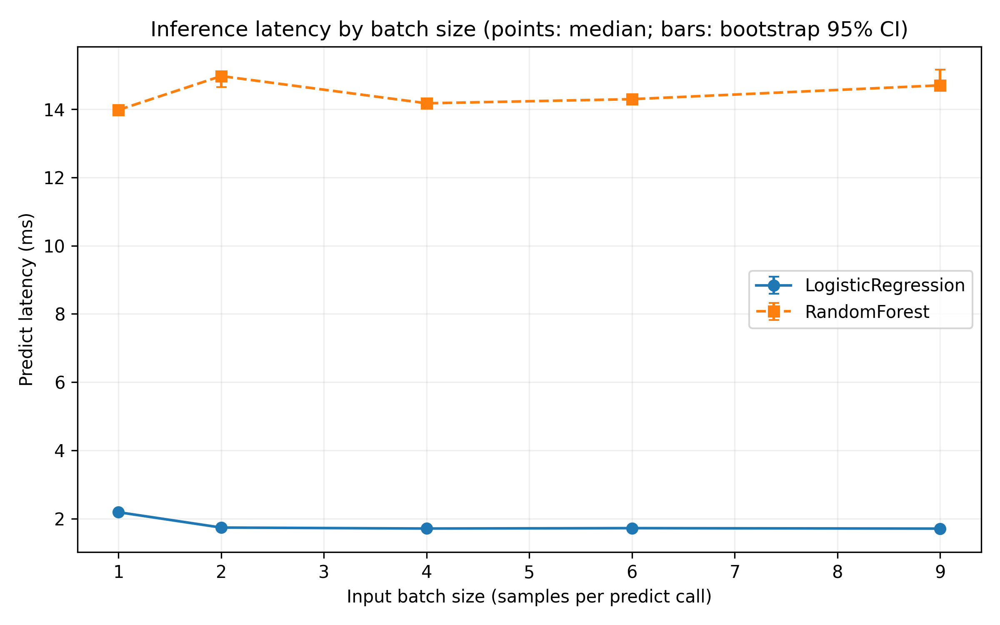
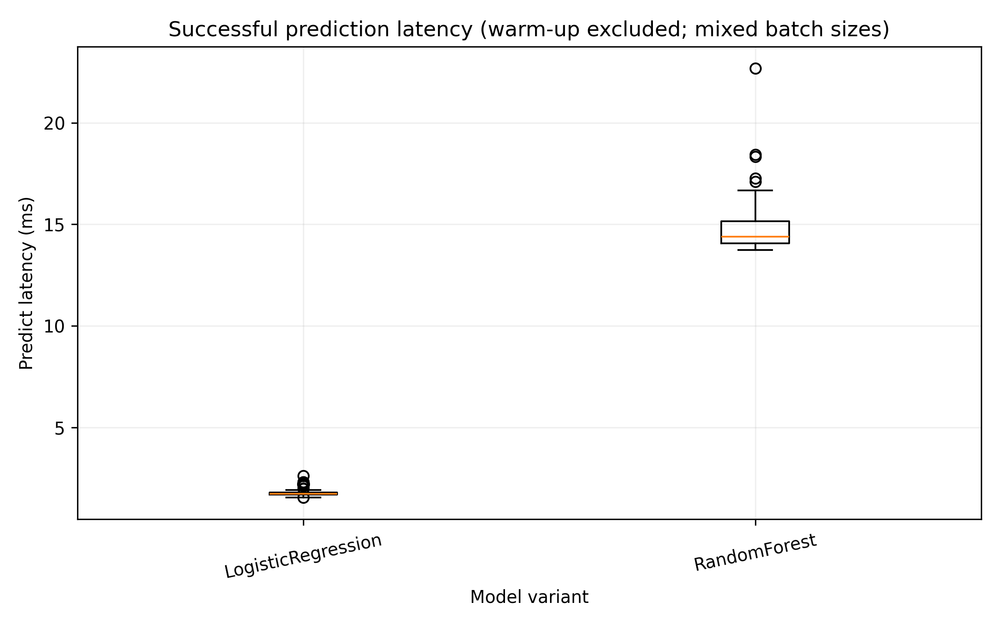

# Phishing Website Detection — Machine Learning Benchmark

**Status:** Reproducible measurement pipeline with recorded UCI inference telemetry. Measurements depend on the machine used and should be regenerated on your Linux system.

## Dataset and Measurement Protocol
- **Input:** UCI Machine Learning Repository, *Phishing Websites*, dataset **327**, 11,055 real labeled website examples, 30 numeric features; DOI: https://doi.org/10.24432/C51W2X.
- **Telemetry:** Each JSONL entry will be a **real elapsed-time measurement** of an actual trained classifier `predict()` call on those data, collected locally on Linux with `time.perf_counter()`. The publicly available input CSV is **not** a set of network traffic logs.
- Label mapping: UCI `-1` = phishing => project `1`; UCI `+1` = legitimate => project `0`.
- The 10-row CSV in `data/sample/` is solely a smoke-test fixture, not research data. Previous toy logs and plots are excluded from this release.

## Linux Quickstart — collect actual measurements
Use Python 3.11 (required by the pinned environment). Run all commands at repository root:

```bash
python3.11 -m venv .venv
source .venv/bin/activate
python -m pip install -r requirements.txt
python -m src.download_uci
python -m src.collect_inference --data data/external/uci327_phishing_websites.csv --out data/raw/test_run.jsonl --runs 120
python -m src.process_data --input data/raw/test_run.jsonl
python -m src.visualize --input data/raw/test_run.jsonl
jupyter lab notebooks/01_data_analysis.ipynb
```

In Jupyter use **Kernel → Restart & Run All**, then save to preserve outputs. Verify the notebook displays calculated statistics and plots.

`python -m src.download_uci` requires internet **only on first download**. The GitHub repository does not include the dataset CSV. Download it from UCI using `python -m src.download_uci`. Dataset provenance and checksums are documented in the repository. For data integrity verification, examine `data/external/uci327_provenance.json` (local dataset SHA256) and `dataset_sha256` in every JSONL record.

## Experimental Methodology
A fixed stratified train/test split (`random_state=42`) trains Logistic Regression (baseline) and Random Forest. For each model and batch size (1, 2, 4, 6, 9), `--runs 120` runs 12 warm-up calls followed by 108 benchmark calls (per condition); elapsed milliseconds are measured from actual `predict()` operations. Logging happens after timing. This is a **CPU inference benchmark**, not real website HTTP traffic, true production throughput or RPS.

`src/process_data.py` validates the log schema, excludes `phase='warmup'`, reports per-model error rate and median, p25/p75, p95/p99, and 2,000 seeded bootstrap resamples for the 95% CI of the median. The bootstrap characterizes repeat-call variability on this setup, not uncertainty across websites or hardware. `src/visualize.py` creates two figures (PDF and 300-DPI PNG) in `reports/figures/`; axes have units, and the latency chart shows uncertainty bars. `docs/domain_model.md` provides ML mathematical notation.

## Experiment artifacts
- `data/raw/test_run.jsonl` — full local measurements (ignored by Git); `data/raw/test_run_sample.jsonl` — 130 authentic measured records spanning all model/batch combinations (committed, for schema inspection only)
- `data/processed/metrics_summary.csv` — saved summary of the full local run (committed; reproduce by running the experiment on Linux)
- `reports/figures/fig1_latency_vs_load.pdf` and `.png`
- `reports/figures/fig2_distribution_boxplot.pdf` and `.png`
- `notebooks/01_data_analysis.ipynb` — executed from scratch with its outputs

### Results & Discussion
The archive includes measured inference telemetry and a grouped summary in [`data/processed/metrics_summary.csv`](data/processed/metrics_summary.csv). These measurements were recorded on the machine that produced the logs; regenerate them on your own Linux machine for reproducible hardware-specific results. The figures below summarize those recorded observations. No claim about production HTTP traffic or general model superiority follows from these measurements.



 Comparing only inference latency does **not** establish phishing detection accuracy; run the separate `src.main` 7×4 benchmark for classification metrics after adapting the dataset configuration.

### Integrity / limitations
The UCI dataset contains derived URL/site attributes, not request arrival times or HTTP status. HTTP-like `status_code` in our JSONL is a **local success/failure marker** (`200` for successful predict, `500` for exception), not a true response from a web server. Measured runtime depends on hardware and concurrent load. Batch size is not requests per second. For a full research claim, assess classification F1/recall with held-out data and repeated cross-validation and discuss dataset provenance / representativeness.

## Repository Structure and Data Management
Large raw logs and dataset CSVs, temporary logs, and `.venv/` are excluded by `.gitignore`; the small real-measurement sample and summary CSV are tracked for review. Review generated figures and notebook before committing them. Old committed dumps must be untracked (`git rm --cached data/raw/sample_test_run.jsonl`) and, if necessary, removed from history with coordinated `git filter-repo`.

## Reproducibility and Citation
Source: [UCI 327 Phishing Websites](https://archive.ics.uci.edu/dataset/327/phishing+websites), DOI 10.24432/C51W2X. See [domain model](docs/domain_model.md) and [data provenance](docs/REAL_DATA_PROVENANCE.md). Source code released under the included MIT LICENSE; source dataset retains its own terms.

### GitHub check
The repository includes a small sample of real telemetry (`data/raw/test_run_sample.jsonl`) to inspect schema and warm-up flags. This sample is **not** the full input that produced `metrics_summary.csv`; reproduce the full run using `bash run_dataset.sh`. The checked-in summary and figures are machine-dependent records from the original measurement environment.
